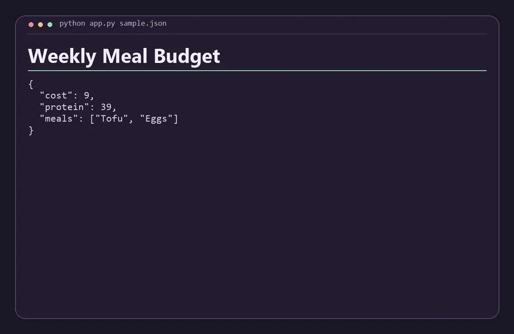

# Weekly Meal Budget

Choose one meal per day to minimize a weekly menu budget while meeting a protein target.



## Run

Install Python 3.11 or newer. Run these commands from the repository root.

```sh
python app.py sample.json
```

Replace `sample.json` with a JSON file following the same structure. The app prints a JSON report to standard output.

Each day contains options in the form [name, cost in whole units, grams of protein]. The target is total protein. An infeasible target returns a null result.

## Verify

Run `python check.py` with Python 3.11 or newer after the build step when applicable. The check verifies the bundled scenario and confirms that an invalid input returns an error.
